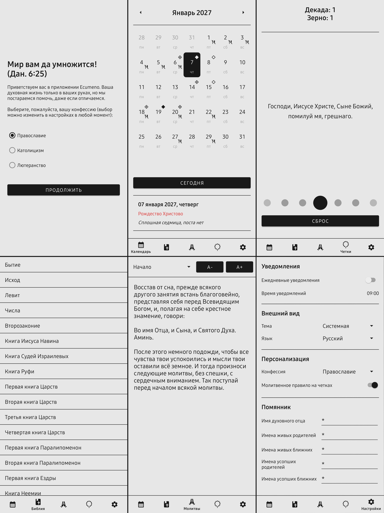
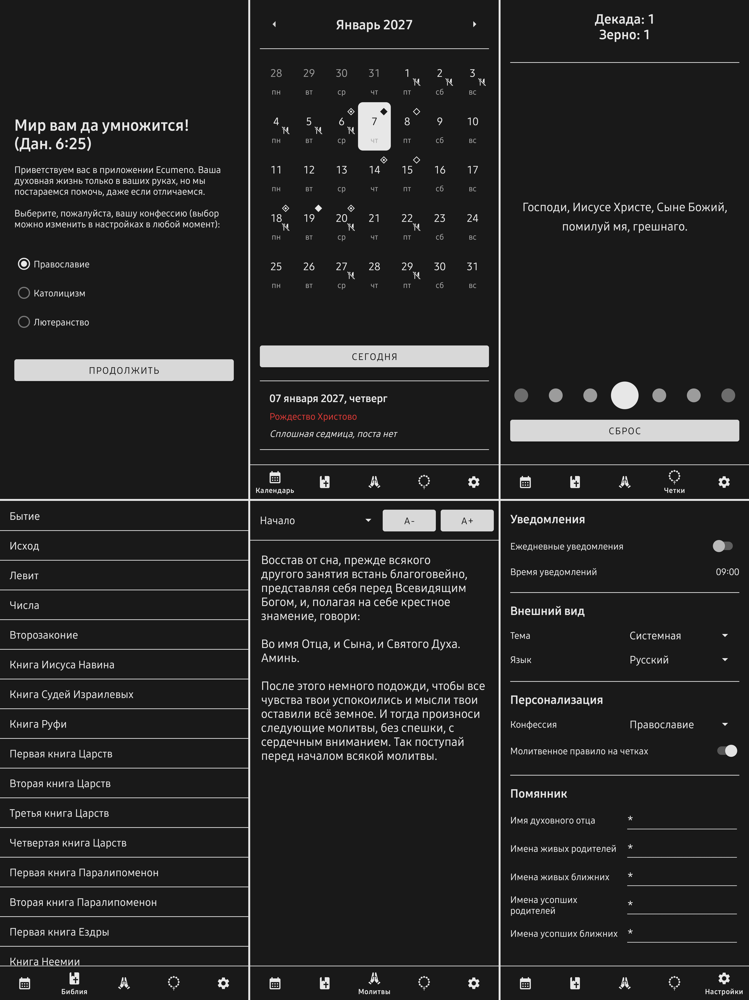

<h1 align="center">Ecumeno</h1>

  

  <b>Русский</b> &nbsp;|&nbsp; <a href="README-en.md">English</a>

  <i>«Отче Святый! соблюди их во имя Твое, тех, которых Ты Мне дал, чтобы они были едино, как и Мы... Да будут все едино, как Ты, Отче, во Мне, и Я в Тебе, так и они да будут в Нас едино» — Евангелие от Иоанна 17:11, 21</i>

  
  
  

<h2>О проекте</h2>

  Данное приложение призвано поддерживать личную духовную жизнь пользователя с учетом особенностей конфессии.
  Ориентировано на христиан и поддерживает три конфессии: православие, католицизм, лютеранство.

<h3>Основной функционал</h3>
<ul>
  <li><b>Календарь (сокращенный, подойдет для мирян)</b></li>
  <li><b>Библия/молитвослов</b></li>
  <li><b>Четки</b></li>
</ul>

<h3>Особенности</h3>
<ul>
  <li><b>Выбор конфессии</b>: Список книг Библии, праздники и посты, варианты четок и молитвослова зависят от конфессии</li>
  <li><b>Автономность:</b> Приложение не имеет доступа к Интернету, все на стороне пользователя</li>
  <li><b>Локализация:</b> Приложение имеет полную поддержку как русского, так и английского языка (также есть русский язык интерфейса с текстами на ЦСЯ)</li>
  <li><b>Уведомления:</b> Имеется поддержка уведомлений в заданное время, с данными о текущем дне (праздники, степень поста), включается в настройках</li>
  <li><b>Молитвенное правило:</b> У каждой конфессии есть четки со своим молитвенным правилом и структурой (отключается в настройках)</li>
  <li><b>Интерактивность:</b> Четки имеют анимированную визуализацию, управляются свайпом или клавишами громкости и вызывают вибрацию</li>
  <li><b>Настраиваемый размер шрифта:</b> При чтении настраивается размер шрифта (общий для молитвослова и Библии)</li>
  <li><b>Сохранение прогресса чтения:</b> При чтении Библии фиксируется последняя открытая книга и глава для восстановления при следующем открытии приложения</li>
  <li><b>Помянник с подстановкой имен:</b> Православные христиане могут указать в настройках имена духовного отца, родителей и ближних (живых и усопших) и избранных святых, имена подставляются в тексты молитв</li>
  <li><b>Пользовательские молитвы:</b> Если включенных по умолчанию молитв не хватает, есть возможность добавить свои (хранятся в отдельной базе и сохранятся при смене настроек)</li>
</ul>

<h3>Скриншоты</h3>

  
  &nbsp;&nbsp;
  

<h3>Технологии и архитектура</h3>
<ul>
  <li><b>Язык:</b> Kotlin</li>
  <li><b>UI:</b> XML Views + View Binding</li>
  <li><b>Архитектура:</b> MVVM с элементами Clean Architecture</li>
  <li><b>Структура:</b> Package-by-feature</li>
  <li><b>Внедрение зависимостей:</b> Ручное</li>
  <li><b>Хранение настроек:</b> DataStore</li>
  <li><b>Управление базой данных:</b> SQLiteOpenHelper</li>
</ul>

<h3>Использованные материалы</h3>
<ul>
  <li><b>Библия:</b> Синодальный перевод, Елизаветинская Библия, Библия короля Якова (KJV) — общественное достояние (текстовые базы данных взяты из открытых модулей проекта <a href="https://mybible.zone/">MyBible</a>)</li>
  <li><b>Православные и католические молитвы на русском и церковнославянском:</b> Избранные тексты из молитвословов в открытых источниках — общественное достояние</li>
  <li><b>Католические молитвы на английском языке:</b> Тексты из сборника «Blessed Be God: A Complete Catholic Prayer Book» (издание 1925 г.) — общественное достояние</li>
  <li><b>Лютеранские молитвы:</b> Малый катехизис Мартина Лютера — общественное достояние</li>
  <li><b>Лютеранские и католические молитвы на церковнославянском языке:</b> Перевод выполнен с помощью генеративного ИИ, в текстах могут содержаться ошибки</li>
</ul>

<h2>Сборка</h2>
<h3>Требования для сборки</h3>
<ul>
  <li>JDK 17 или новее</li>
  <li>Android SDK</li>
</ul>

<h3>Инструкция по сборке</h3>
<ol>
  <li>Клонируйте репозиторий:</li>
</ol>

<pre>
  <code>git clone https://github.com/tyr0v-k/Ecumeno.git</code>
</pre>

<ol start="2">
  <li>Запустите скрипт сборки из корня репозитория:</li>
</ol>

<pre>
  <code>./gradlew assembleRelease</code>
</pre>

<ol start="3">
  <li>APK будет находиться в директории:</li>
</ol>

<pre>
  <code>app/build/outputs/apk/release/</code>
</pre>

<h2>Скачать</h2>

  
  &nbsp;&nbsp;
  

<h2>Рекомендуемые проекты</h2>
<ul>
  <li><b><a href="https://mybible.zone/">MyBible</a>:</b> Мощный универсальный инструмент для изучения Библии со множеством модулей, гибкими настройками и открытой архитектурой данных</li>
  <li><b><a href="https://azbyka.ru/">Азбука Веры</a>:</b> Один из крупнейших православных порталов в русскоязычном сегменте. Включает обширную святоотеческую библиотеку, календарь и функциональную систему параллельного сравнения библейских переводов</li>
  <li><b><a href="https://ruscatholic.org/">Рускатолик.рф</a>:</b> Главный католический информационно-просветительский портал в России, предлагающий переводы классических духовных трудов, катехизические материалы и собственное мобильное приложение</li>
</ul>

<h2>Поддержать разработчика</h2>

<i>«Молитесь друг за друга, чтобы исцелиться: много может усиленная молитва праведного» — Послание Иакова 5:16</i>

  
  &nbsp;&nbsp;
  
  &nbsp;&nbsp;
  

